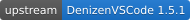

<div align="center">

# MINEZ DenizenVSCode

A fork of the [Denizen VS Code extension](https://github.com/DenizenScript/DenizenVSCode) maintained for the MINEZ server.

<a href="README.md">English</a> ｜
<a href="docs/README_zh-CN.md">简体中文</a>

<br>

<div>
<a href="https://github.com/DenizenScript/DenizenVSCode"></a>
<a href="LICENSE.txt"></a>
</div>

<br>

<a href="https://denizen-meta.minez.cc/">Documentation</a> ｜
<a href="https://github.com/MINEZ/DenizenVSCode/issues">Issue Tracker</a> ｜
<a href="https://github.com/MINEZ/DenizenVSCode/releases">Releases</a> ｜
<a href="#changes-from-upstream">What's Changed</a>

</div>

> [!IMPORTANT]
> **This is an unofficial fork and is not affiliated with, endorsed by, or supported by the DenizenScript team.**
>
> Never take anything about this fork to the upstream repository, the official Discord, or the forums. Use [this repository's issue tracker](https://github.com/MINEZ/DenizenVSCode/issues) instead.
>
> To tell the two apart, reproduce the problem with the official extension from the Marketplace first:
>
> - **It still happens without this fork** — an upstream problem. Report it upstream as you normally would, with no mention of this fork.
> - **It does not happen without this fork** — ours. It belongs here, and only here.

## About

This repository tracks the upstream `master` branch. It provides language support for `.dsc` files written for [MINEZ/Denizen](https://github.com/MINEZ/Denizen): syntax highlighting, error checking, autocompletion and hover docs, all driven by the meta of that fork rather than the official one. Everything not listed below is identical to upstream.

Our commits follow upstream by rebase, so the history stays linear:

```bash
git fetch upstream
git rebase upstream/master
```

Because rebasing rewrites commit hashes, pushing after a sync requires `git push origin master --force-with-lease`.

## Installation

The extension is not published to the Marketplace. Download the `.vsix` file from [Releases](https://github.com/MINEZ/DenizenVSCode/releases), then either pick **Install from VSIX…** from the `…` menu of the Extensions view, or run:

```bash
code --install-extension denizenscript-minez-<version>.vsix
```

Installing a newer `.vsix` replaces the older one in place.

This extension and the official one can be installed side by side, but they handle the same files, so every warning and hover entry would show up twice. Disable the official extension, at least in the workspaces where this one is used. Both read the same `denizenscript.*` settings, so nothing needs to be configured again.

You can enable auto-indenting by opening `.vscode/settings.json` and adding:

```json
{
    "[denizenscript]": {
        "editor.autoIndent": "full",
    }
}
```

## Changes from Upstream

| Name | Type | Change |
| --- | --- | --- |
| Extension ID | Packaging | Changed |
| Meta sources | Behaviour | Changed |
| `dialog` script container | Checking & highlighting | Added |
| Meta Docs links | Behaviour | Changed |

**Extension ID.** VS Code identifies an extension by its publisher and name. With both left as upstream had them, VS Code would treat a local build as the official extension, and the next Marketplace update would silently replace it — taking every change below with it. The name is now `denizenscript-minez`, making the ID `denizenscript.denizenscript-minez`, and the display name is "DenizenScript (MINEZ)". The language ID and the `denizenscript.*` settings namespace are unchanged.

**Meta sources.** The language server is built on [MINEZ/SharpDenizenTools](https://github.com/MINEZ/SharpDenizenTools) instead of the upstream library. Checking, completion and hover docs therefore follow the meta of MINEZ/Denizen, MINEZ/DenizenCore and MINEZ/Depenizen, plus the Denizen integration that [CraftEngine](https://github.com/Xiao-MoMi/craft-engine) ships with. Commands, tags and events that only exist in this fork or in CraftEngine are recognised instead of being reported as unknown. See that repository for the full list of changes to checking.

**`dialog` script container.** Scripts of `type: dialog` are checked rather than rejected as an unknown script type. The script names listed under `dialogs` are no longer coloured as if they were Denizen commands.

**Meta Docs links.** The "Meta Docs" links in hover and completion tooltips point at [denizen-meta.minez.cc](https://denizen-meta.minez.cc/), which is built from the same meta the extension uses. They used to point at the official site, where anything specific to this fork leads to a 404.

## Building

Requires the [.NET 8 SDK](https://dotnet.microsoft.com/download/dotnet/8.0) and [Node.js](https://nodejs.org/). Clone with submodules, since the language server is built from the SharpDenizenTools submodule:

```bash
git clone --recursive https://github.com/MINEZ/DenizenVSCode
```

1. Within `DenizenLangServer/`, build the language server with `dotnet build --configuration Release`.
2. Copy everything in `DenizenLangServer/bin/Release/net8.0/` into `extension/server/`.
3. Within `extension/`, run `npm install`, then `npm install -g typescript @vscode/vsce`.
4. Within `extension/`, run `vsce package`. This compiles the TypeScript sources and writes `denizenscript-minez-<version>.vsix` next to them.

To debug instead, open the repository in VS Code and press F5 (it helps to have `extension.ts` open).

Packaging also regenerates the upstream badge at the top of this page from the version in `extension/package.json`, so it never has to be updated by hand. When upstream bumps its version, commit the regenerated `docs/badges/upstream.svg` along with the sync.

## Versioning

The version in `extension/package.json` follows upstream unchanged, so the `.vsix` file carries the upstream version. Fork revisions are recorded in the release tag instead: `v1.5.1.1` is the first release of this fork based on upstream 1.5.1. VS Code requires a three-part version, which is why the fork revision cannot go into `package.json` itself.

## Related Repositories

| Repository | Purpose |
| --- | --- |
| [MINEZ/Denizen](https://github.com/MINEZ/Denizen) | Scripting engine whose meta this extension follows |
| [MINEZ/SharpDenizenTools](https://github.com/MINEZ/SharpDenizenTools) | Meta and script-checking library behind the language server |
| [MINEZ/DenizenMetaWebsite](https://github.com/MINEZ/DenizenMetaWebsite) | Documentation site the hover links point at, deployed at [denizen-meta.minez.cc](https://denizen-meta.minez.cc/) |

## Upstream

The Denizen VS Code extension is developed by [the DenizenScript team](https://denizenscript.com/) and published on the [Marketplace](https://marketplace.visualstudio.com/items?itemName=DenizenScript.denizenscript). For learning the language itself, the [beginner's guide](https://guide.denizenscript.com/) and the [Discord](https://discord.gg/Q6pZGSR) remain the right places to go — for the language as upstream ships it, not for anything in this fork.

The changes here are built for one server's needs and are maintained separately. Please keep discussion of them out of upstream's channels.

## License

The Denizen VS Code extension is open source under the MIT License, Copyright (c) The Denizen Scripting Team. Modifications in this fork are provided under the same terms. See [LICENSE.txt](LICENSE.txt) for the full text.

The short of it: you can do basically whatever you want, except hold any developer liable for what you do with the software.
